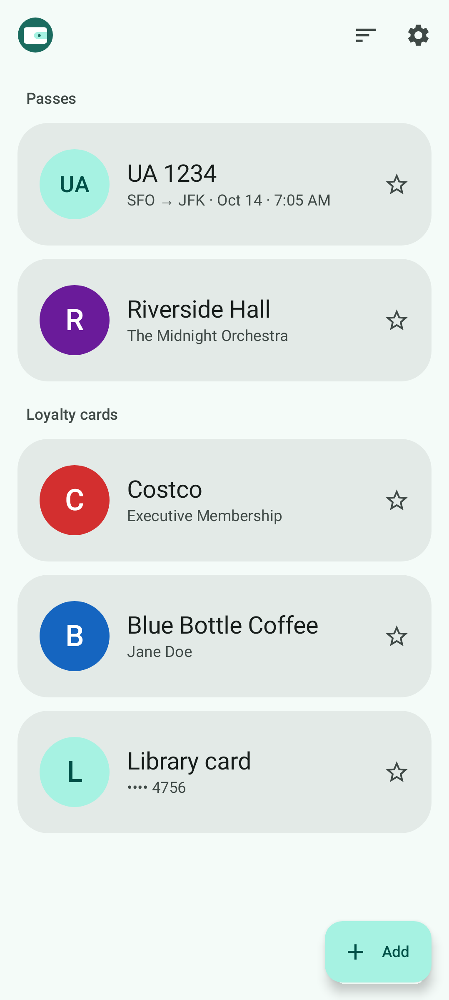
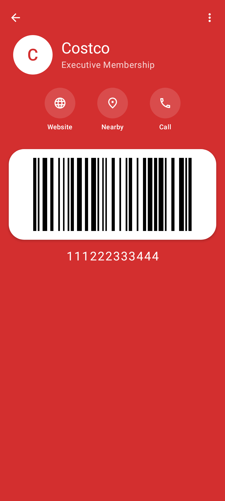
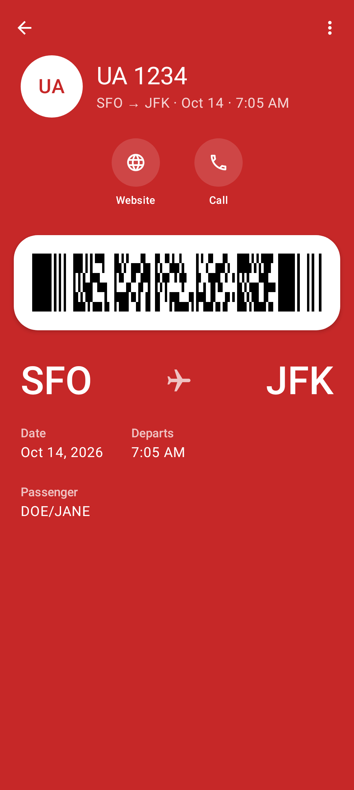

# Clasp

A calm, private wallet for loyalty cards and passes on Android. No payments, no accounts. Offline unless you turn on logo search.

<p>
  
  
  
</p>

## Features

- **Loyalty cards:** scan a barcode or QR code, or type the number in. Star favorites to keep them on top, and sort by recent use, name or date.
- **Boarding passes:** scan the barcode on a paper or mobile boarding pass, including multi-leg itineraries.
- **Apple Wallet passes:** open `.pkpass` files from email, the web or a file manager.
- **Google Wallet import:** bring in the cards and passes from a [Google Takeout](https://takeout.google.com/) export of Google Wallet.
- **Quick actions:** open a card's website, find a nearby store, or call customer service.
- **Backups:** export your whole wallet to a file and restore it on any phone.
- **Themes:** light and dark, with dynamic color on Android 12 and later.

Clasp needs Android 8.0 or later.

## Install

Download the signed APK from [GitHub Releases](https://github.com/pxgray/clasp/releases), or build it from source (see [Development](#development)). Clasp is on its way to F-Droid; both builds are signed with the same key, so either can update the other.

## Privacy

Clasp has no accounts, analytics or ads, and keeps everything on your phone. The only network feature is **logo search**, which is off until you agree to it (the first time you tap *Find logo*, or in Settings → Online). When it's on and you search:

- the search text is sent to [Wikidata](https://www.wikidata.org/) and matching logos are downloaded from Wikimedia Commons;
- if the card has a website, Clasp fetches that site's home page and icons.

Like any web request, these let Wikimedia and the card's website see your IP address, and Clasp identifies itself to them as Clasp and its version (the User-Agent). Only the logo you pick is saved, as a local file. Showing a card never uses the network.

## Development

Requirements: Android Studio (for its bundled JDK and the Android SDK at `~/Android/Sdk`).

```bash
echo "sdk.dir=$HOME/Android/Sdk" > local.properties
env JAVA_HOME=/opt/android-studio/jbr ./gradlew assembleDebug        # build
env JAVA_HOME=/opt/android-studio/jbr ./gradlew testDebugUnitTest    # tests (JVM + Robolectric)
env JAVA_HOME=/opt/android-studio/jbr ./gradlew installDebug         # install on a connected device
env JAVA_HOME=/opt/android-studio/jbr ./gradlew verifyRoborazziDebug # compare screens with golden images
env JAVA_HOME=/opt/android-studio/jbr ./gradlew recordRoborazziDebug # re-record goldens after an intended UI change
```

## Reporting a security issue

Please report security problems privately. See [SECURITY.md](SECURITY.md).

## AI usage

Clasp is developed with the help of AI. Most of the code, tests and design documents were
written by Claude (Anthropic), working in Claude Code under the direction of the maintainer,
who made the product and design decisions and reviewed the changes. Commits with AI
contributions carry a `Co-Authored-By: Claude` trailer.

Contributions are welcome whether or not you use AI tools; all changes are held to the same
review and testing standards.

## License

Copyright (C) 2026 Patrick X. Gray

Clasp is free software: you can redistribute it and/or modify it under the terms of the
GNU General Public License as published by the Free Software Foundation, either version 3
of the License, or (at your option) any later version. See [LICENSE](LICENSE).

Clasp is distributed in the hope that it will be useful, but WITHOUT ANY WARRANTY; without
even the implied warranty of MERCHANTABILITY or FITNESS FOR A PARTICULAR PURPOSE.
